<p align="center">
  
</p>

<h1 align="center">MochiDock</h1>

<p align="center">
  <b>A dynamic-island companion for Windows.</b><br>
  A native .NET 8 WPF overlay at the top of your screen for media &amp; lyrics, live PC &amp; gaming telemetry, quiet notifications, taskbar readouts, and an expressive mascot.
</p>

<p align="center">
  <a href="https://github.com/sleepisfun17/MochiDock/actions/workflows/ci.yml"></a>
  <a href="https://github.com/sleepisfun17/MochiDock/releases/latest"></a>
</p>

<p align="center">
  <a href="#feature-demos">Feature demos</a> ·
  <a href="#themes-mascots-and-quick-settings">Themes &amp; mascots</a> ·
  <a href="#all-features">All features</a> ·
  <a href="#requirements">Requirements</a> ·
  <a href="#install">Install</a> ·
  <a href="#build-from-source">Build</a>
</p>

> **Beta.** Many features have been built and unit-tested cleanly, though not every integration has been verified across a wide range of machines. See the [changelog and known limitations](CHANGELOG.md).

<p align="center">
  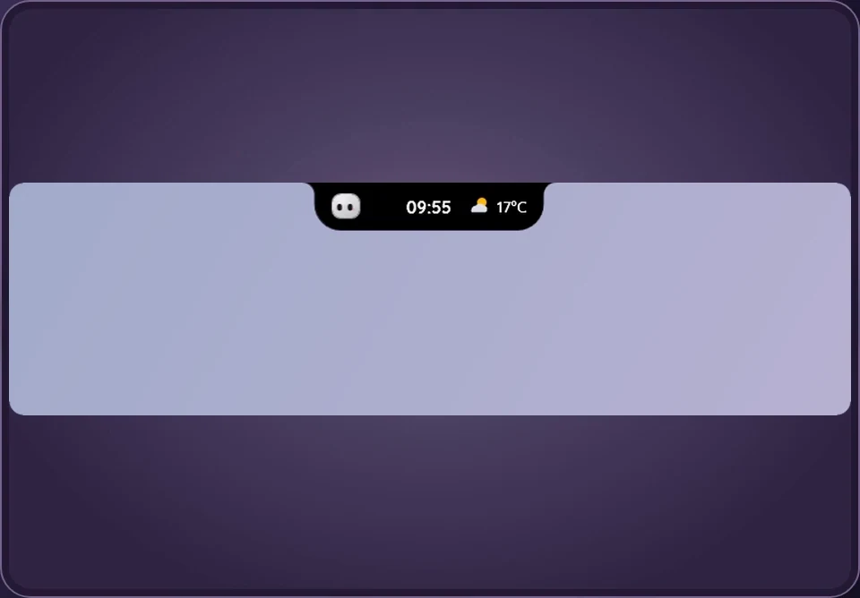<br>
  <sub><a href="docs/media/mochidock-dock.png">Still (PNG)</a> · <a href="docs/media/mochidock-dock.mp4">Video (MP4)</a></sub>
</p>

## What it is

MochiDock sits quietly at the top of your monitor as a compact pill — notched or floating — and expands smoothly when hovered. Open it to control playback and synced lyrics, inspect live CPU/GPU/power telemetry, read messages without switching windows, check the weather or prayer schedule, and more.

- **Compact first:** Resting clock and weather pills, paced one-line capsule lyrics, and non-intrusive notification banners that expand only when you hover.
- **Built for desktop & gaming:** Real-time ETW FPS, GPU/CPU temps with colour limits, click-through overlay, taskbar system strips, and per-game resolution/window shortcuts.
- **Quiet multi-source inbox:** WhatsApp, Email (IMAP, Outlook Classic, Mailspring), Discord, and Windows apps (all apps or selected), with per-source Mute, Snooze, Quiet hours, and Gaming DND.
- **4 themes & 5 mascots:** Switch between `Default`, `Hojicha`, `Kuro Night`, and `Matcha`, and pair them with grey Mochi, Matcha Mochi, Hojicha Mochi, Kuro, or Shiro.

---

## Feature demos

### Media & synced lyrics

Controls for Spotify, YouTube Music, and browser playback via Windows GSMTC, a seekable timeline, and synced LRCLIB lyrics — with automatic Japanese, Korean, and Chinese readings/furigana and paced compact capsule scrolling.

<p align="center">
  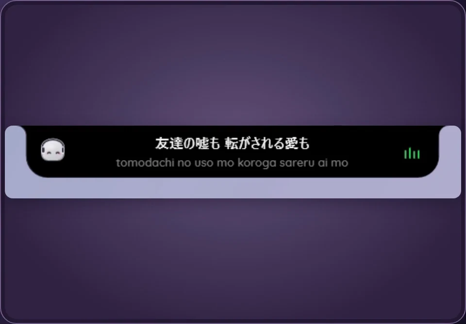<br>
  <sub><a href="docs/media/mochidock-japanese-lyrics.png">Still (PNG)</a> · <a href="docs/media/mochidock-japanese-lyrics.mp4">Video (MP4)</a></sub>
</p>

### Live stats, network & power

Real-time **Stats** views for CPU (per-core bars, clocks, temps), GPU, Memory, Drives, Network (upload/download speed, usage trajectory, ping), Top Processes, 24-hour history, **Power & Batteries** (stacked desktop CPU/GPU/other wattage or laptop draw), and wireless mouse/keyboard/headset battery levels.

<p align="center">
  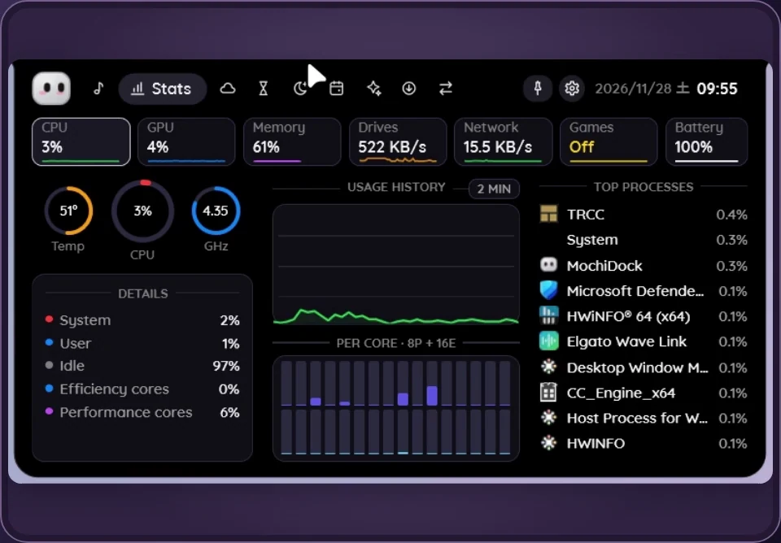<br>
  <sub><b>Live Stats:</b> <a href="docs/media/mochidock-live-stats.png">Still (PNG)</a> · <a href="docs/media/mochidock-live-stats.mp4">Video (MP4)</a></sub>
</p>

<p align="center">
  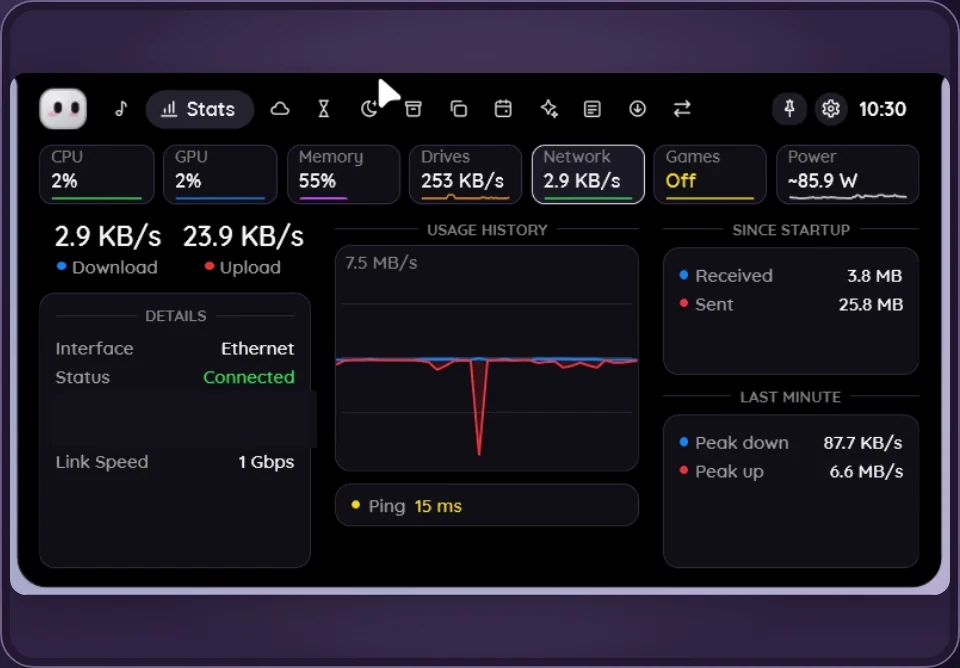<br>
  <sub><b>Network:</b> <a href="docs/media/mochidock-network.png">Still (PNG)</a> · <a href="docs/media/mochidock-network.mp4">Video (MP4)</a></sub>
</p>

<p align="center">
  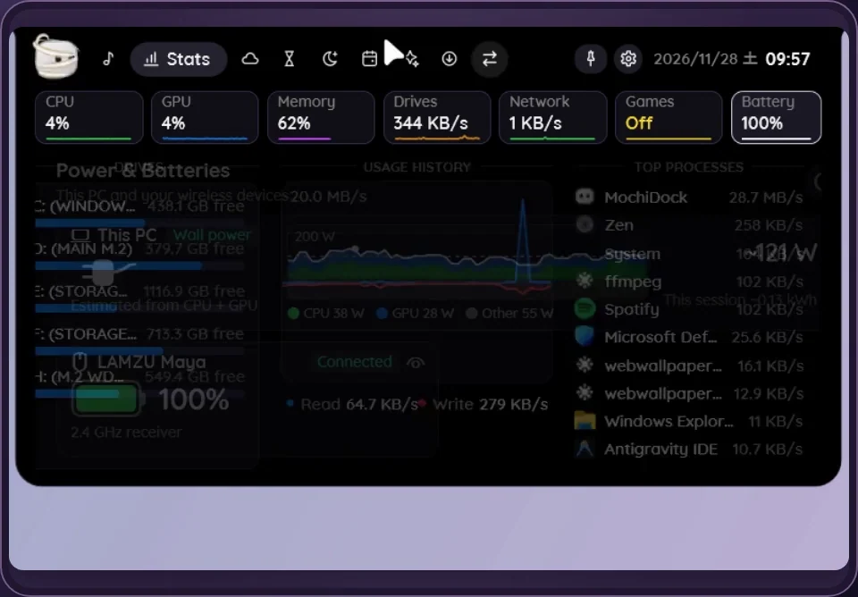<br>
  <sub><b>Power &amp; Wireless Batteries:</b> <a href="docs/media/mochidock-power.png">Still (PNG)</a> · <a href="docs/media/mochidock-power.mp4">Video (MP4)</a></sub>
</p>

### Gaming overlay & window shortcuts

While a game runs (or when pinned from **Stats > Games**), the capsule switches to a low-profile **FPS | GPU | CPU** HUD:

- **Live telemetry & thermal limits:** Captures ETW FPS without injecting into games, shows GPU/CPU usage and measured temperatures (CPU temp via optional PawnIO), and lets you configure separate **Orange** and **Red** limits per component — unified with hardware alerts and taskbar warnings.
- **Session tools:** Optional click-through, configurable Floating top offset, end-of-session summary (avg, 1% / 0.1% lows, stutters, optional League of Legends / PUBG match stats), Today/Week playtime, break reminders, and compact weather.
- **Display & window hotkeys:** Toggle between native and gaming resolutions (`Ctrl+Alt+R`), or resize/centre windows into preset sizes (`Ctrl+Alt+1–4`) and flip landscape/portrait (`Ctrl+Alt+F`).

<p align="center">
  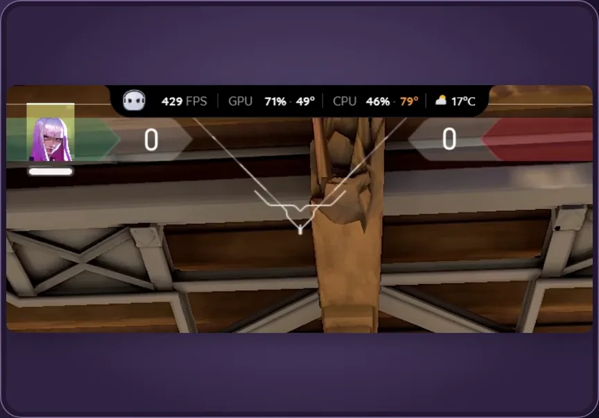<br>
  <sub><a href="docs/media/mochidock-gaming.png">Still (PNG)</a> · <a href="docs/media/mochidock-gaming.mp4">Video (MP4)</a></sub>
</p>

### Taskbar readouts

Compact two-line blocks placed directly on the Windows taskbar (left edge, left of the tray, or after task buttons) across one or all displays:

- **Customizable blocks & layout:** Toggle CPU/GPU load and temp, Memory, Disk, Upload/Download, Prayer time, Weather, and wireless batteries; assign items to **Left** or **Right** zones; choose fonts, arrow styles, compact labels, and Windhawk tall-taskbar scaling.
- **Interactive controls:** Hover any block for a themed 1-second MochiDock hover card, click to open its dock tab, or right-click to move/hide blocks cleanly.

<p align="center">
  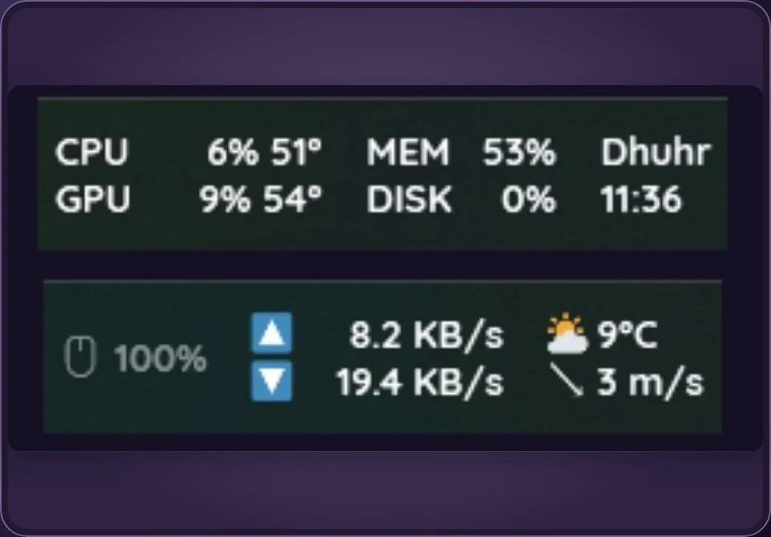<br>
  <sub><a href="docs/media/mochidock-taskbar.png">Still (PNG)</a> · <a href="docs/media/mochidock-taskbar.mp4">Video (MP4)</a></sub>
</p>

### Weather & daily companions

Optional daily modules you can switch on anytime from **Settings > Tabs & Modules**: **Weather** (with day/night capsule badges and rain-soon notices), **Prayer times** (Aladhan schedule, schematic timeline with active prayer & Dhuha period glow, qibla bearing, offline moon phase, Tone/Silent reminders), **FX rates** (25 currencies with 7D/1M/1Y charts and no API key), **Today** (month calendar, `.ics` feeds, inline-editable & snoozable tasks & reminders), **Pomodoro**, **AI usage**, **File Shelf** (local Wi-Fi Phone Drop), **Clipboard**, **Script** teleprompter (`Alt+Shift+S`), and **Downloads** (`yt-dlp` + `ffmpeg`).

<p align="center">
  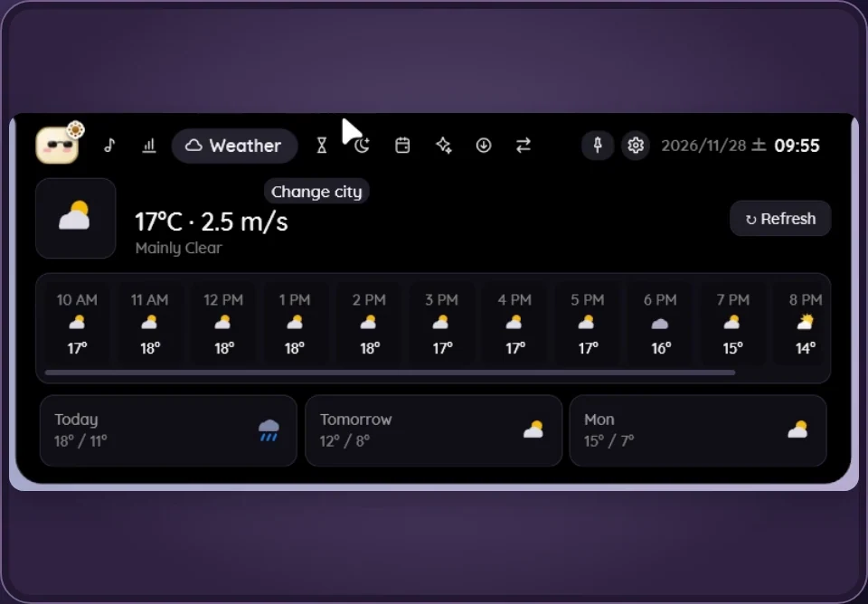<br>
  <sub><b>Weather:</b> <a href="docs/media/mochidock-weather.png">Still (PNG)</a> · <a href="docs/media/mochidock-weather.mp4">Video (MP4)</a></sub>
</p>

<p align="center">
  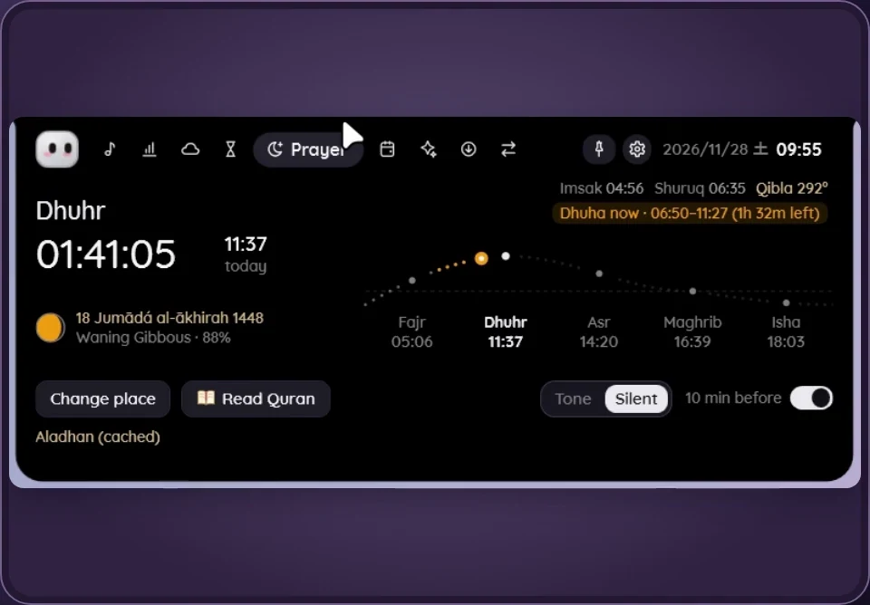<br>
  <sub><b>Prayer times &amp; moon phase:</b> <a href="docs/media/mochidock-prayer.png">Still (PNG)</a> · <a href="docs/media/mochidock-prayer.mp4">Video (MP4)</a></sub>
</p>

<p align="center">
  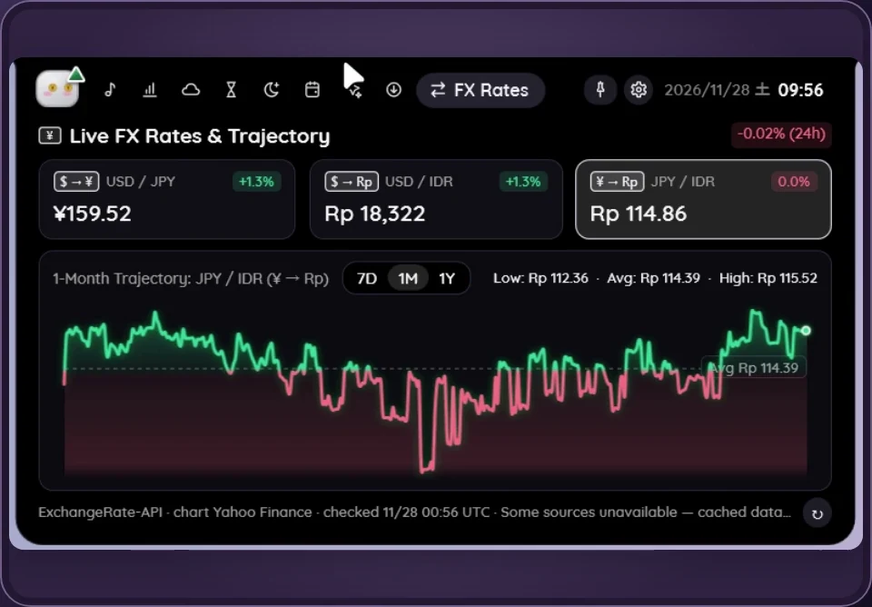<br>
  <sub><b>FX Rates:</b> <a href="docs/media/mochidock-fx-rates.png">Still (PNG)</a> · <a href="docs/media/mochidock-fx-rates.mp4">Video (MP4)</a></sub>
</p>

### Notifications & focus

- **Multi-source inbox:** WhatsApp (multi-account with short aliases, quick replies & emoji reactions), Email (Gmail/IMAP app-password, Outlook Classic, Mailspring, one-click verification code copy), Discord, and all or selected Windows app notifications on the **Apps** card.
- **Stay in control:** Colour emoji support in the compact capsule, clear selection ring when multiple messages are queued, **Mute** per source (silences popups/sounds while keeping incoming messages stored in their tabs so you can review them later), 1h/8h **Snooze**, **Quiet hours**, and **Quiet while gaming** with allow-listed contacts.

---

## Themes, mascots and quick settings

Switch between `Default` (dark), `Hojicha` (warm roasted-tea brown), `Kuro Night` (storm-night indigo), and `Matcha` (warm oat and green) in the dock's **Quick Settings** or searchable 5-group **Settings** window. Pair any theme with **Auto**, grey **Mochi**, **Matcha Mochi**, **Hojicha Mochi**, **Kuro** (electric black cat), or **Shiro** (white cat), toggle the **Cat mouth** (`:3`) option for Kuro & Shiro, and pick your status badge style (**3D Charm**, **Speech Bubble**, **3D Sticker**, or **Off**).

<p align="center">
  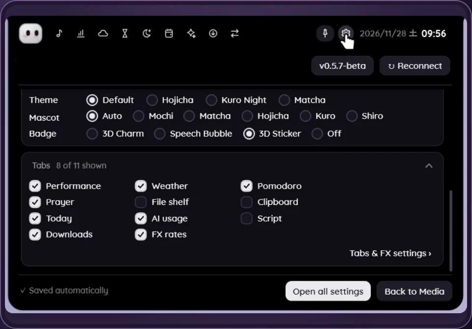<br>
  <sub><b>Theme switching in Quick Settings:</b> <a href="docs/media/mochidock-themes.png">Still (PNG)</a> · <a href="docs/media/mochidock-themes.mp4">Video (MP4)</a></sub>
</p>

<p align="center">
  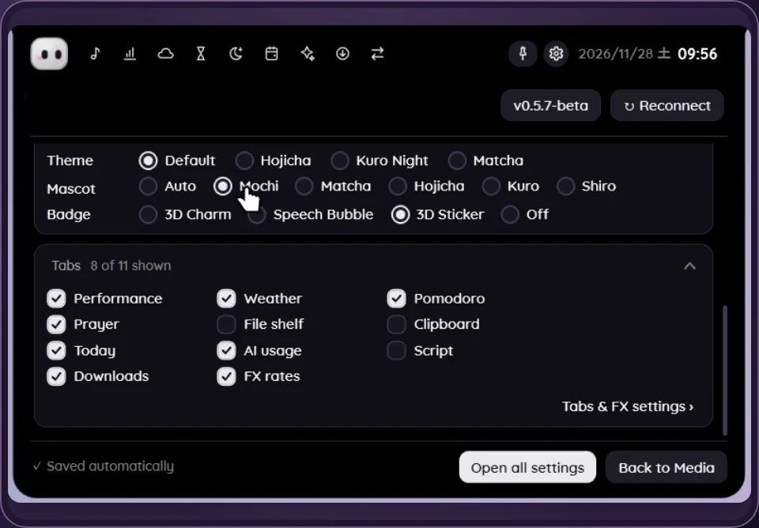<br>
  <sub><b>Mascot switching &amp; spin:</b> <a href="docs/media/mochidock-mascots.png">Still (PNG)</a> · <a href="docs/media/mochidock-mascots.mp4">Video (MP4)</a></sub>
</p>

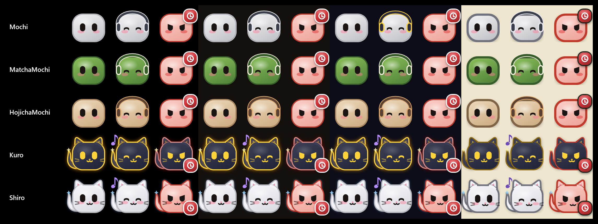

[What triggers each mascot expression](docs/USER_GUIDE.md#mochis-faces)

<details>
<summary><strong>View all 38 mascot expressions (Default, Matcha, Kuro &amp; Shiro)</strong></summary>


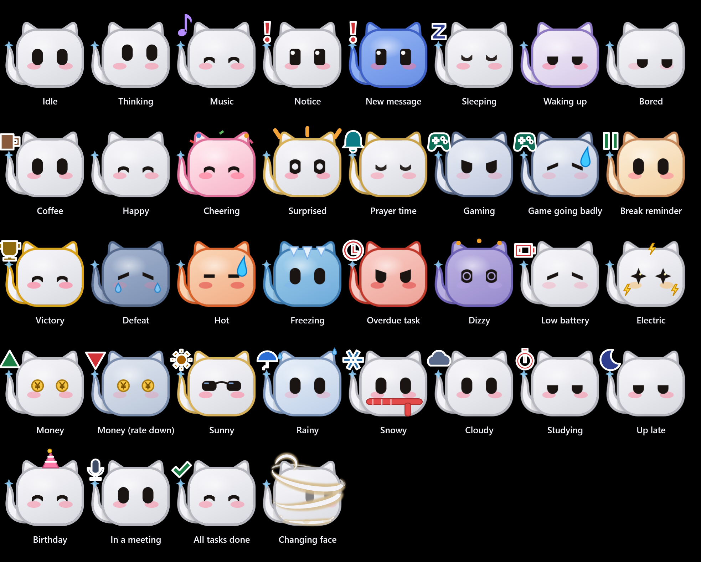

</details>

<details>
<summary><strong>More card &amp; theme screenshots (Default, Matcha &amp; Kuro Night)</strong></summary>

| Default | Matcha | Kuro Night |
| --- | --- | --- |
| 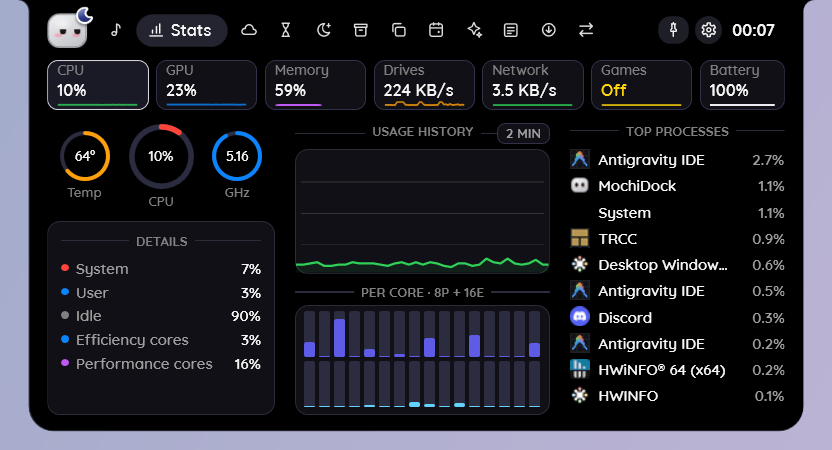 | 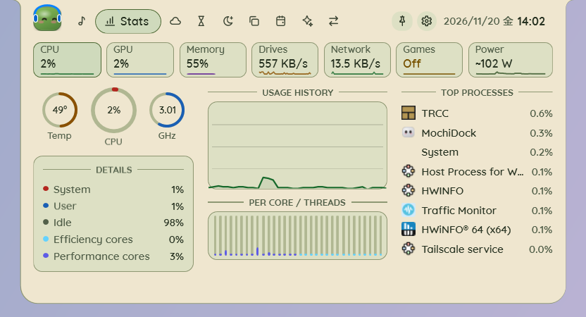 | 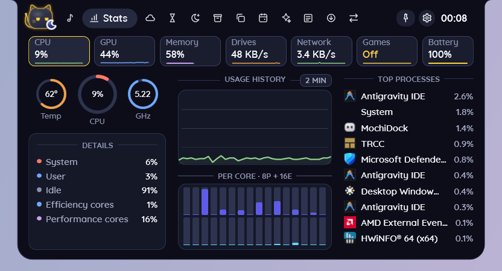 |
|  | 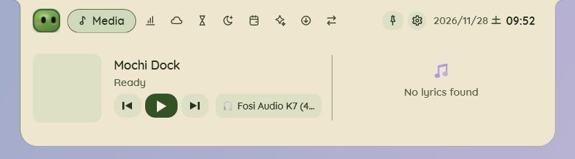 |  |
| 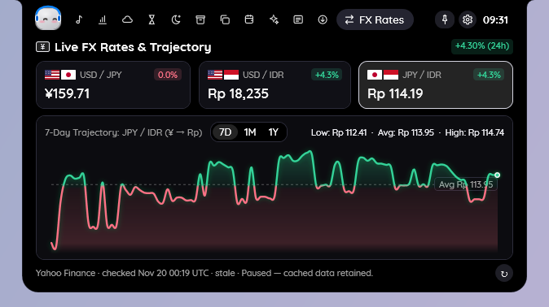 | 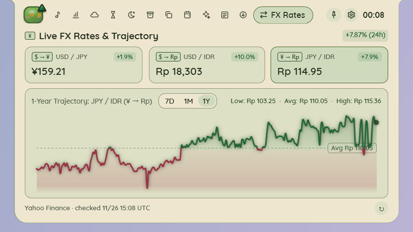 | 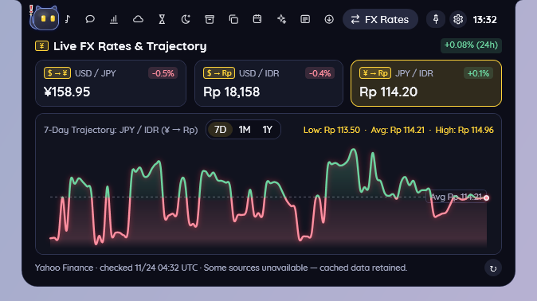 |
|  |  |  |

<table>
  <tr>
    <td></td>
    <td></td>
  </tr>
  <tr>
    <td colspan="2">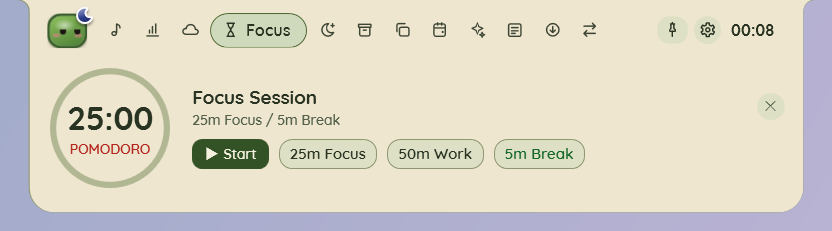</td>
  </tr>
  <tr>
    <td colspan="2">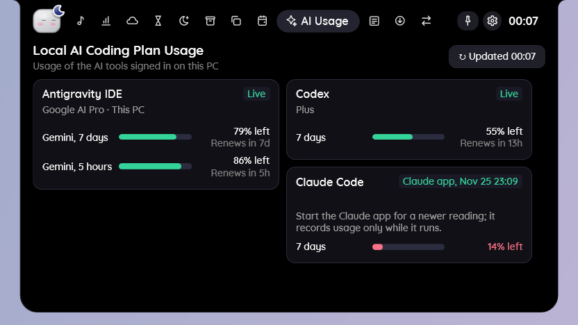</td>
  </tr>
</table>

The compact media capsule in `Default`, `Matcha`, and `Kuro Night`:


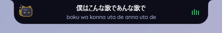

</details>

---

## All features

A new install starts focused: **Media**, **Stats**, and **Weather** tabs, plus desktop notifications and gaming mode. Switch anything else on from the tray icon or the gear button (**Settings > Tabs & Modules**, or use the sidebar search box to jump straight to any setting).

| Feature | What it does | New install | Where to switch it |
| --- | --- | --- | --- |
| **Media & lyrics** | Playback controls (Spotify, YouTube Music, browsers), seekable timeline, and LRCLIB synced lyrics with Japanese, Korean, and Chinese readings. | On | Always shown; lyrics in Music & Lyrics |
| **Stats** | CPU (per-core bars), GPU, memory, drives, network, top processes, 24 h history, and Battery & Power page. | On | Tabs & Modules |
| **Weather** | Current conditions, hourly and 3-day outlook, capsule badge, and rain-soon notices. | On | Tabs & Modules; city in Location & Prayer |
| **Gaming mode** | Compact FPS, GPU & CPU usage/temps with separate Orange/Red limits, optional click-through, Floating top offset, playtime/session summary, and `Ctrl+Alt+R` resolution toggle. | On | Gaming & Display; temp limits in Hardware & Power |
| **Notifications** | Compact pill notices that expand on hover; selection ring when several wait; per-source Mute keeps messages quietly stored in tabs; Apps card for all or selected Windows apps. | Email & Discord on, WhatsApp off, other apps none | Notifications, Email, WhatsApp |
| **WhatsApp** | Multi-account messages, aliases, quick replies, reactions, and read-sync via local or shared GOWA engine (starts nothing until enabled). | Off | WhatsApp |
| **Email** | IMAP accounts (Gmail, Yahoo, iCloud with app password), Outlook Classic, Mailspring; verification code copy. | Ready, add an account | Email |
| **Prayer times** | Location-aware Aladhan schedule, schematic timeline with active prayer & Dhuha period glow, qibla bearing, offline moon phase, Tone/Silent reminders. | Off | Tabs & Modules, or Location & Prayer |
| **Today & calendar** | Month calendar, up to 10 named, colour-coded Google Calendar / `.ics` links (Work, Personal & more; [setup guide](docs/USER_GUIDE.md#connecting-google-calendar)), automatic & right-click mascot schedule badges (`Meeting`, `Eating`, `Gym`, `Working` with 45 min Coffee breaks), tasks with inline edit, snooze/reschedule & reminders, optional Japan/Indonesia holidays. | Off | Tabs & Modules; links & holidays in Calendar |
| **FX rates** | Three currency pairs from 25 currencies (defaults USD/JPY, USD/IDR, JPY/IDR) with trajectory chart, no API key required. | Off | Tabs & Modules |
| **AI usage** | Remaining quota tracking (with fractional % precision) for Claude, Codex, Antigravity, Cursor, Gemini, and GitHub Copilot, with optional low-usage alert. | Off | Tabs & Modules; providers in AI Usage |
| **Taskbar readouts** | Custom Left/Right blocks beside the tray (CPU, GPU, memory, disk, network, prayer, weather, batteries) with themed hover cards & block menus. | Off | Taskbar |
| **Wireless device batteries** | Mouse, keyboard, and headset levels on the Battery page and taskbar readout. | Off | Hardware & Power, Taskbar |
| **Window-size shortcuts** | Global hotkeys to resize/centre the foreground window (`Ctrl+Alt+1–4`) or swap width/height (`Ctrl+Alt+F`). | Off | Gaming & Display |
| **Pomodoro, File Shelf, Clipboard, Script, Downloads** | Focus timer; Wi-Fi Phone Drop shelf; clipboard history; teleprompter (`Alt+Shift+S`); media downloader (`yt-dlp` + `ffmpeg`). | Off | Tabs & Modules |
| **Mascots & badges** | 5 characters, optional `:3` cat mouth for Kuro & Shiro, 4 status badge styles with live preview, and mood triggers ([mood guide](docs/USER_GUIDE.md#mochis-faces)). | On | Mascot |
| **Updates** | Checks GitHub Releases (4-hour interval & manual check chip), persistent subtle `↑` dot + expandable banner until dismissed, and SHA-256 verified silent setup + relaunch. | Check on | Quick settings chip; Updates & Data |

Full per-tab and per-setting reference: [User guide](docs/USER_GUIDE.md).

## Requirements

- Windows 10 version 2004 (build 19041) or later, or Windows 11, 64-bit.
- Nothing extra is needed for the basics. Optional per feature:
  - **GPU stats:** GPU name, driver, and usage read from Windows WMI and GPU Engine counters (NVIDIA, AMD, Intel). NVIDIA drivers expose extra detail via NVML; on AMD and Intel, temperature/clock/power read from hardware sensors where exposed or display `-` otherwise (verified across an NVIDIA laptop GPU, AMD desktop GPU, and Intel integrated graphics).
  - **PawnIO:** Real CPU temperature (optional third-party kernel driver — can be ticked during setup via winget, or managed in **Settings > Hardware & Power > Sensors & history**). Without it, CPU temperature is an estimate marked with `~` and stays hidden in the gaming FPS pill. PC power estimation uses Windows' Energy Meter counters when PawnIO is unavailable.
  - **Email:** Gmail, Yahoo, iCloud, or other IMAP account with an app password ([setup notes](docs/USER_GUIDE.md#setting-up-email-gmail-and-other-imap-accounts)), Outlook Classic, or Mailspring.
  - **Calendar:** One or more Google Calendar or `.ics` links (up to 10, named and colour-coded; [guide](docs/USER_GUIDE.md#connecting-google-calendar)).
  - **`ffmpeg.exe`:** Required only for MP3 audio extraction/merging in **Downloads**.

## Install

1. Download `MochiDock-Setup-<version>.exe` from [GitHub Releases](https://github.com/sleepisfun17/MochiDock/releases) and run it (self-contained; no separate .NET runtime required).
2. Because the installer is an **unsigned beta**, Windows SmartScreen may warn — choose **More info → Run anyway**.
3. MochiDock requires **Administrator privileges** for ETW FPS capture, so UAC prompts on manual launch; enabling **Start with Windows** uses an elevated interactive logon task to launch without a prompt.

**Updating & uninstalling:** Installed copies update in-app via the version chip in Quick Settings, the tray menu, or **Settings > Updates & Data** (SHA-256 verified before running silently). Uninstalling via **Windows Settings > Apps** asks whether to keep settings/data, always deletes DPAPI-encrypted secrets, and reminds you to revoke any email app password at your provider. See [updating and uninstalling](docs/USER_GUIDE.md#updating-and-uninstalling).

## Build from source

Requires the [.NET 8 SDK](https://dotnet.microsoft.com/download/dotnet/8.0). From the repository root:

```powershell
dotnet build MochiDock/MochiDock.csproj -c Release
dotnet test MochiDock.Tests/MochiDock.Tests.csproj -c Release
```

Build the installer (Inno Setup 6 required; outputs `installer\Output\MochiDock-Setup-<version>.exe`):

```powershell
.\scripts\build_installer.bat
```

`scripts\build_and_publish.bat` publishes a framework-dependent portable build into `Publish\` (requires the .NET 8 Windows Desktop Runtime). Additional commands and headless render harnesses live in the [developer documentation](docs/README.md).

## Data and privacy

- **Storage:** Settings and tasks live in `%AppData%\MochiDock`. Caches, logs, and local WhatsApp (GOWA) session data live in `%LocalAppData%\MochiDock`. Phone drop and shared GOWA servers use unencrypted local-network HTTP.
- **Updates:** Automatic/manual update checks only query this repository's GitHub Releases API and verify downloads against GitHub's SHA-256 digest before execution.
- **Credentials:** Mail app passwords, shared GOWA server tokens, and Google Calendar links are encrypted for your Windows user with Windows DPAPI in `%LocalAppData%\MochiDock` — never in `settings.json`, exports, or logs. Removing an email account or uninstalling MochiDock deletes its saved credential immediately.

## Issues and ideas

Bug reports, hardware feedback, and feature suggestions are welcome on [GitHub Issues](https://github.com/sleepisfun17/MochiDock/issues).

## Credits

The idea for MochiDock came from [coucou](https://github.com/Louis-CFM/coucou), a notch companion for macOS: MochiDock is a lightweight take on the concept for Windows. Some card layouts were influenced by [Oyenza Studio](https://github.com/lucacadalora/oyenza-studio). All application code — including lyric lookup, Japanese/Korean/Chinese pronunciation pipelines, and AI usage readers — is its own. Card icons use [Microsoft Fluent Emoji](https://github.com/microsoft/fluentui-emoji) (MIT). Full libraries, data sources, fonts, and hardware protocol notices are listed in [third-party notices](THIRD-PARTY-NOTICES.txt).

MochiDock is an independent project and is not affiliated with or endorsed by any third-party service or product trademarked above.

## Documentation and licence

- [User guide](docs/USER_GUIDE.md): every tab, notification rule, and WhatsApp/Email/Calendar setup.
- [Developer documentation](docs/README.md): project layout, render harnesses, feature verification status, and human checklist.
- [Changelog](CHANGELOG.md) and known limitations.
- [MIT licence](LICENSE).
- [Third-party notices](THIRD-PARTY-NOTICES.txt).
