<p align="center">
  
</p>

<h1 align="center">MochiDock</h1>

<p align="center"><b>A dynamic-island companion for Windows.</b><br>
A native .NET 8 WPF overlay at the top of your screen for media, messages, hardware stats and more.</p>

<p align="center"><a href="https://github.com/sleepisfun17/MochiDock/actions/workflows/ci.yml"></a> <a href="https://github.com/sleepisfun17/MochiDock/releases/latest"></a></p>

> **Beta.** Many features have been built and unit-tested but not yet verified on a wide range of machines. See the [known limitations](CHANGELOG.md).

<p align="center">
  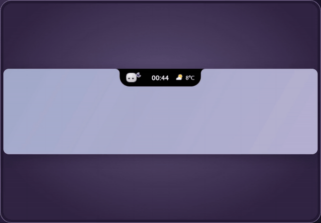
</p>

## What it is

MochiDock is a small capsule that lives at the top of your screen. Notifications appear as a compact pill and expand when you hover. Open it to see what is playing, new messages, your PC's stats, the weather, your day and more. Mochi, a small mascot, reacts to music, alerts, games, battery and the time of day.

[Dock still (PNG)](docs/media/mochidock-dock.png) · [Dock demo (MP4)](docs/media/mochidock-dock.mp4)

## Features

A new install starts small: the **Media**, **Stats** and **Weather** tabs, plus the notifications and gaming mode. Everything else is one switch away. Tabs are switched in **Settings > Tabs & Modules** (or the switches on the dock's own Settings tab); the other features in the Settings section named below. Open Settings from the tray icon or the gear on the dock (use the sidebar search box to jump straight to any option).

| Feature | What it does | New install | Where to switch it |
| --- | --- | --- | --- |
| **Media and lyrics** | Controls for Spotify, YouTube Music and browser playback, a seekable timeline and synced lyrics (LRCLIB) with readings for Japanese, Korean and Chinese. | On | Always shown; lyrics in Music & Lyrics |
| **[Stats](#live-stats)** | CPU, GPU, memory, drives, network, top processes and a Battery page. | On | Tabs & Modules |
| **[Weather](#weather)** | Current weather, hourly and three-day forecast, and the temperature in the capsule. | On | Tabs & Modules; city in Location & Prayer |
| **Gaming mode** | Shows FPS, GPU and CPU with optional click-through and a session summary. In Floating mode the dock uses a configurable offset from the top. Ctrl+Alt+R switches between screen resolution presets. | On | Gaming & Display |
| **Notifications** | WhatsApp, Email and Discord messages appear as a small capsule first and expand on hover; when several arrive, clicking one highlights the active message you are viewing or replying to. Notifications from other apps you choose (LINE, Telegram, Slack...) get their own Apps card. | Email and Discord on, WhatsApp off, other apps none | WhatsApp, Email, Notifications |
| **WhatsApp** | Recent messages, quick replies and reactions through a local or shared GOWA engine. Starts nothing until you enable it. | Off | WhatsApp |
| **Email** | New-mail notices from Gmail or other IMAP accounts (app password), Outlook Classic and Mailspring; verification codes can be copied. | Ready, add an account | Email |
| **Prayer times** | Location-aware schedule, qibla bearing, reminders and a Tone or Silent chime. | Off | Tabs & Modules, or Location & Prayer |
| **Today and calendar** | Month calendar, events from a Google Calendar link ([how to connect it](docs/USER_GUIDE.md#connecting-google-calendar)), tasks with reminders, optional Japan and Indonesia holidays. | Off | Tabs & Modules; link and holidays in Calendar |
| **FX rates** | Three currency pairs of your choice from 25 currencies (default USD/JPY, USD/IDR and JPY/IDR) with a trajectory chart, no API key needed. | Off | Tabs & Modules |
| **AI usage** | Remaining usage for Claude, Codex, Antigravity, Cursor, Gemini and GitHub Copilot, with an optional low-usage alert. | Off | Tabs & Modules; providers in AI Usage |
| **[Taskbar readouts](#taskbar-readouts)** | Two-line blocks beside the system tray: CPU and GPU, memory and disk, network speed, the next prayer, the weather and device batteries; click one to open its card. | Off | Taskbar |
| **Wireless device batteries** | Mouse, keyboard and headset levels on the Stats Battery page and an optional taskbar readout. | Off | Hardware & Power, Taskbar |
| **Window-size shortcuts** | Resize the window you are using to a set size and centre it (Ctrl+Alt+1 to 4, Ctrl+Alt+F to swap width and height; editable). | Off | Gaming & Display |
| **Pomodoro** | Focus timer. | Off | Tabs & Modules |
| **File Shelf** | A temporary shelf for files, and phone drop over your Wi-Fi (you approve each file). | Off | Tabs & Modules |
| **Clipboard** | Clipboard history. | Off | Tabs & Modules |
| **Script** | A teleprompter-style script reader (Alt+Shift+S). | Off | Tabs & Modules |
| **Downloads** | A media downloader (yt-dlp and ffmpeg). | Off | Tabs & Modules |
| **Sounds** | Short notification and Mochi sounds. | On | Notifications |
| **[Mascots](#mascots)** | The mascot's faces follow what is going on (music, messages, games, the weather, a hot GPU, overdue tasks…) and the card you open (Electric on the Battery page, Money on FX, the sky on Weather, Studying during a Pomodoro). He spins round in a little whirlwind when his face changes, and you can choose his corner status badge style (**3D Charm**, **Speech Bubble**, **3D Sticker** or **Off**) with a live preview. [Every face and its trigger](docs/USER_GUIDE.md#mochis-faces). | On | Mascot |
| **Updates** | Checks GitHub for a new version and shows a one-time capsule notice when one is out; until you dismiss that version, a small accent ↑ dot stays on the compact capsule (it steps aside for gaming, notifications and notices) and the expanded dock shows a banner with **Update**, **Release notes** and **Dismiss**. The version button at the top of the dock's quick settings checks on click and turns into **Update to x** when an update is waiting; it downloads the update, verifies its checksum, installs it silently and restarts MochiDock. Nothing installs without your click. | Check on | Quick settings button; automatic checks in Updates & Data |

Four themes, `Default` (dark), `Hojicha` (warm roasted-tea brown with a caramel accent), `Kuro Night` (storm-night indigo with an electric-yellow accent, where Mochi becomes Kuro, a black electric cat) and `Matcha` (warm oat and green), are in **Appearance & Dock** alongside the dock style, monitor and interface size. **Mascot** holds the character picker (Auto, grey Mochi, Matcha Mochi, Hojicha Mochi, Kuro the black cat or Shiro the white cat, with any theme; also in the dock's quick settings), status badge style with a live preview, Expressive Mochi and your birthday; **General** holds startup, fullscreen/capture behavior and date format. MochiDock is multi-monitor and high-DPI aware. The [user guide](docs/USER_GUIDE.md) explains every tab and setting.

## Feature demos

### Live Stats

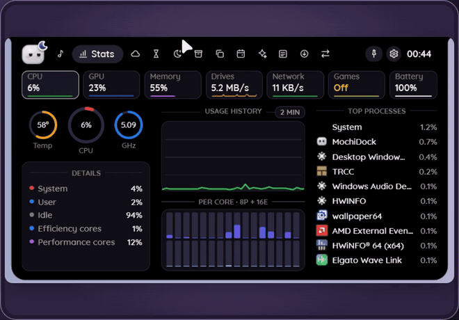

[Stats still (PNG)](docs/media/mochidock-live-stats.png) · [Stats demo (MP4)](docs/media/mochidock-live-stats.mp4)

The Network page shows upload and download rates, usage history and ping. [Network GIF](docs/media/mochidock-network.gif) · [Network still (PNG)](docs/media/mochidock-network.png) · [Network demo (MP4)](docs/media/mochidock-network.mp4)

### Weather

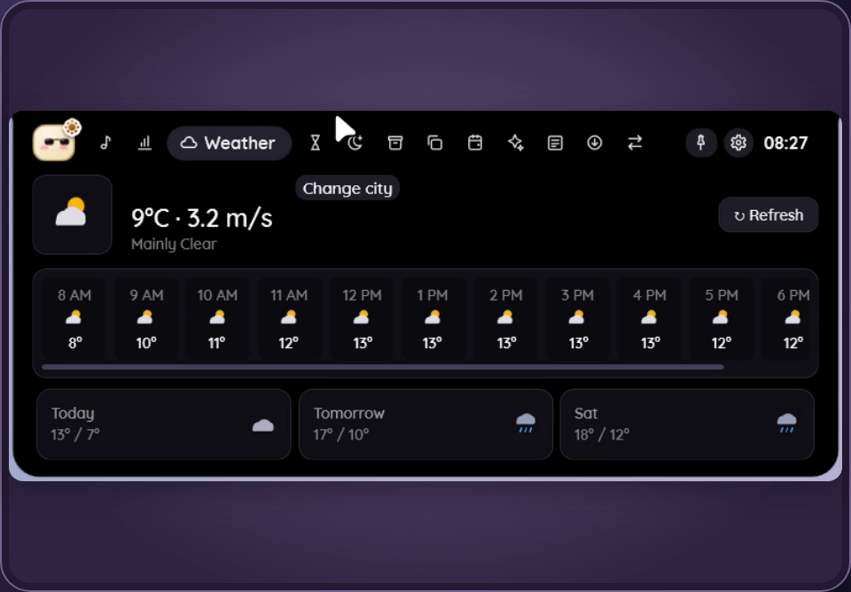

[Weather GIF](docs/media/mochidock-weather.gif) · [Weather demo (MP4)](docs/media/mochidock-weather.mp4)

### Taskbar readouts

Choose which blocks appear in **Settings > Taskbar**.

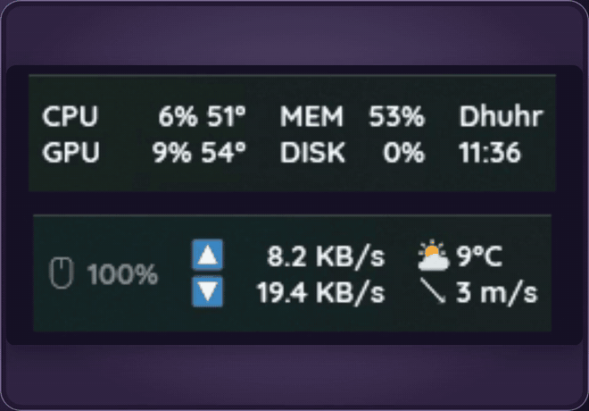

[View a still image (PNG)](docs/media/mochidock-taskbar.png) · [Open the video (MP4)](docs/media/mochidock-taskbar.mp4)

## Screenshots

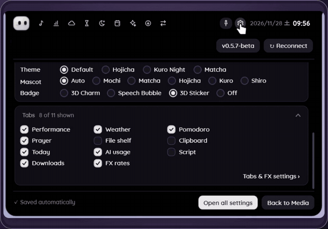

[Theme still (PNG)](docs/media/mochidock-themes.png) · [Theme demo (MP4)](docs/media/mochidock-themes.mp4)

| Default | Matcha | Kuro Night |
| --- | --- | --- |
|  |  |  |
| 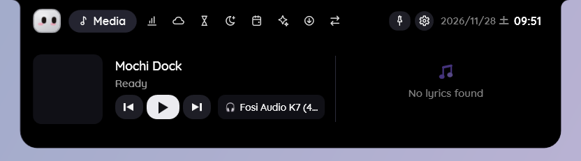 |  | 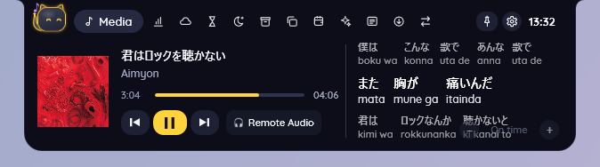 |
|  |  |  |
| 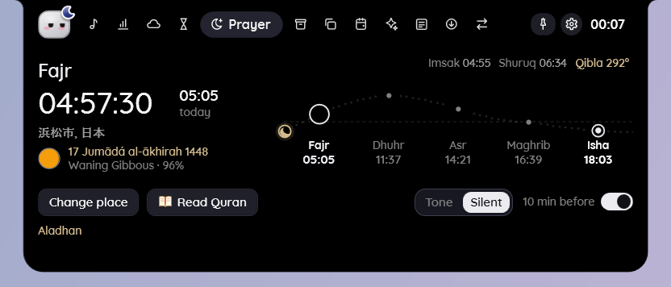 | 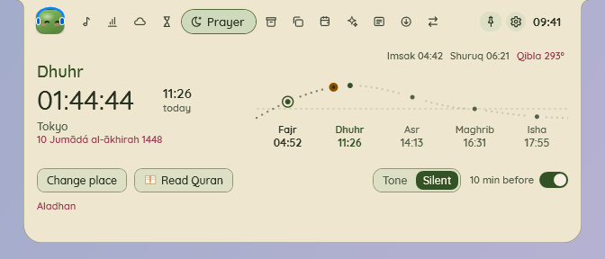 | 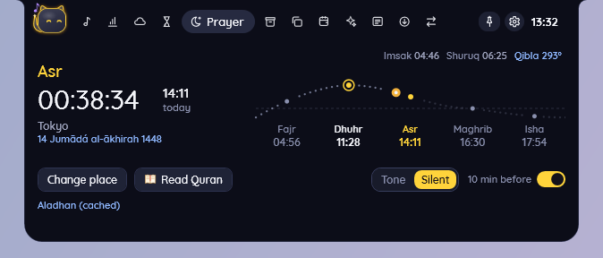 |

<table>
  <tr>
    <td>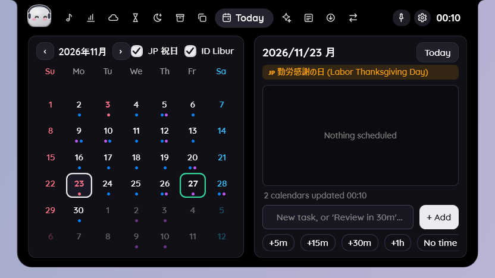</td>
    <td>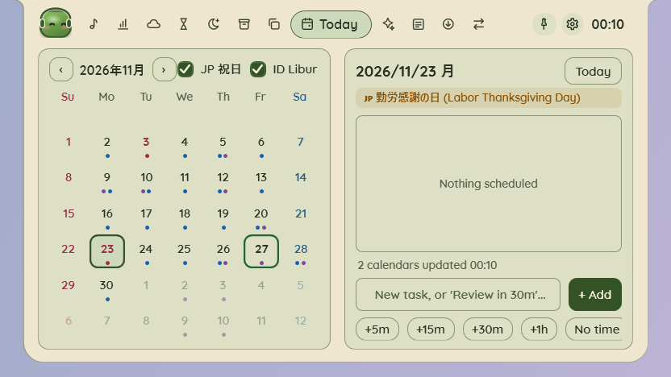</td>
  </tr>
  <tr>
    <td colspan="2"></td>
  </tr>
  <tr>
    <td colspan="2"></td>
  </tr>
</table>

The compact capsule in the Default, Matcha and Kuro Night themes, here showing the current song:

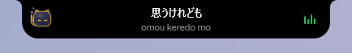
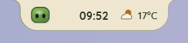


### Mascots

Choose a character in **Settings > Mascot**. **Auto** follows the selected theme.


[What triggers each expression](docs/USER_GUIDE.md#mochis-faces)

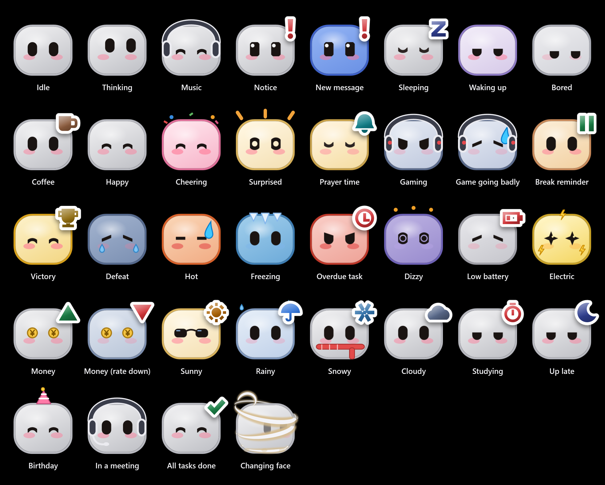

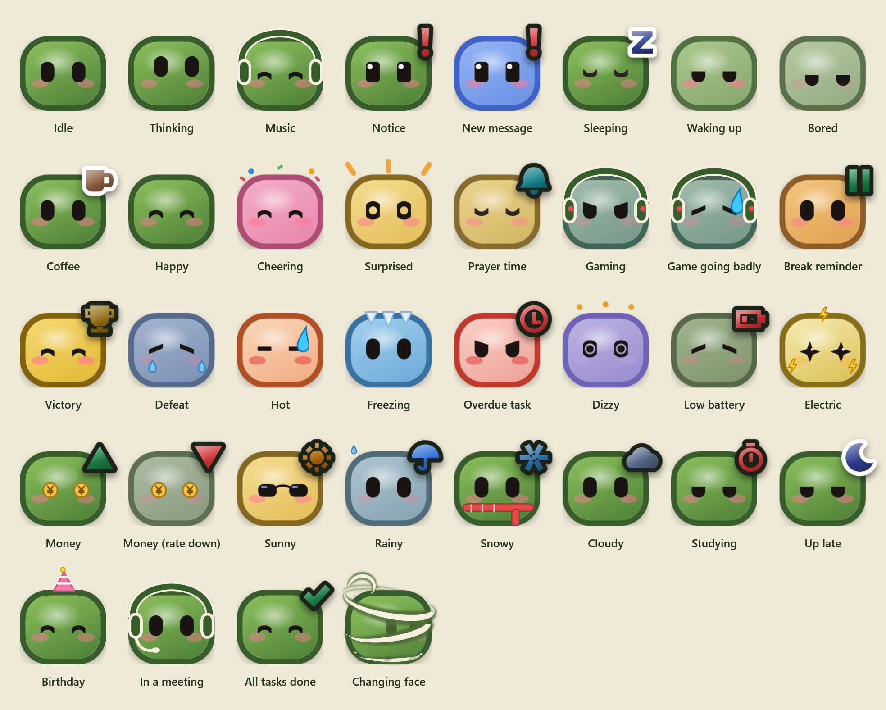

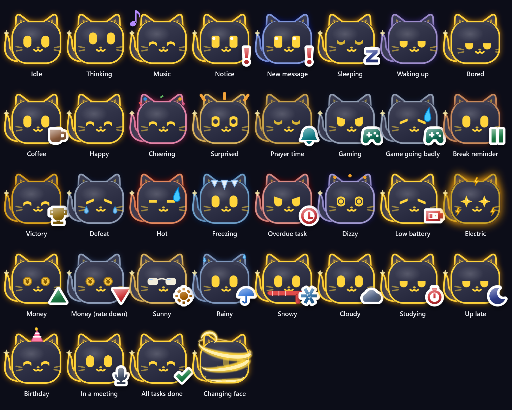


The mascot spins as it changes from Kuro to Shiro in quick settings.

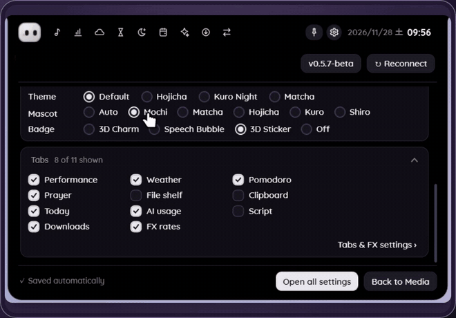

[Mascot still (PNG)](docs/media/mochidock-mascots.png) · [Mascot demo (MP4)](docs/media/mochidock-mascots.mp4)

## Requirements

- Windows 10 version 2004 (build 19041) or later, or Windows 11, 64-bit.
- Nothing else is required for the basics. Optional, each for its own feature:
  - **GPU stats:** GPU name, driver and usage come from Windows itself (WMI and the GPU Engine counters), so they work with NVIDIA, AMD and Intel graphics. An NVIDIA driver adds more detail (temperature, memory, clock and power through NVML); on AMD and Intel those extra values are read from hardware sensors when available and show as `-` otherwise. Checked on real hardware with an NVIDIA laptop GPU, an AMD desktop GPU and an Intel CPU with integrated graphics (on the Intel iGPU no GPU temperature sensor is reported, so temperature stays as `-`).
  - **PawnIO:** a real CPU temperature (a separate third-party driver; the setup can install it for you with winget if you tick the option, or see Settings > Hardware & Power > CPU sensors). Without it the CPU temperature is an estimate, marked with `~`. It is not needed for the power total on the Battery page: CPU power is read from Windows' own Energy Meter counters when PawnIO is missing (on Intel CPUs with integrated graphics that figure already includes the graphics). GPU power needs an NVIDIA card or a sensor that provides it; the total is always marked as an estimate.
  - **Email:** a Gmail, Yahoo, iCloud or other IMAP account with an app password (Gmail only offers app passwords once 2-step verification is on; see [setting up email](docs/USER_GUIDE.md#setting-up-email-gmail-and-other-imap-accounts)), or classic Outlook or Mailspring.
  - **Calendar:** a Google Calendar (or other `.ics`) link, see the [user guide](docs/USER_GUIDE.md#connecting-google-calendar).
  - **`ffmpeg.exe`** (MP3 in Downloads).

## Install

1. Download `MochiDock-Setup-<version>.exe` from the [GitHub Releases](https://github.com/sleepisfun17/MochiDock/releases) page and run it. The installer is self-contained and needs no .NET runtime.
2. The installer is an **unsigned beta**, so Windows SmartScreen may warn. Choose "More info", then "Run anyway".
3. MochiDock needs **Administrator rights** (FPS capture uses ETW), so Windows asks for approval each time it starts. The optional "Start with Windows" task launches it elevated without a prompt.

**Updating:** you only download the setup once. Later versions install from inside MochiDock (the version button in the dock's quick settings, the tray menu, or Settings > Updates & Data), keeping your settings.

**Uninstalling:** use Windows Settings > Apps. The uninstaller asks whether to keep your settings and data, always deletes saved passwords, and reminds you to revoke a mail app password at your provider. See [updating and uninstalling](docs/USER_GUIDE.md#updating-and-uninstalling).

## Build from source

Requires the .NET 8 SDK. From the repository root:

```powershell
dotnet build MochiDock/MochiDock.csproj -c Release
dotnet test MochiDock.Tests/MochiDock.Tests.csproj -c Release
```

To build the installer (Inno Setup 6 required, output `installer\Output\MochiDock-Setup-<version>.exe`):

```powershell
.\scripts\build_installer.bat
```

`scripts\build_and_publish.bat` publishes a portable build to `Publish\` (requires the .NET 8 Windows Desktop Runtime). More commands and the render harnesses are in the [developer documentation](docs/README.md).

## Data and privacy

Settings and tasks live in `%AppData%\MochiDock`. Caches and the WhatsApp (GOWA) session live in `%LocalAppData%\MochiDock`. Phone drop and a shared GOWA server use plain HTTP on your local network, which is not encrypted. Update checks and **Update now** only contact this project's GitHub releases, and a downloaded update is checked against GitHub's SHA-256 checksum before it runs.

**Saved passwords.** Mail app passwords, the shared WhatsApp server login and the calendar link are stored encrypted for your Windows user (Windows DPAPI) in `%LocalAppData%\MochiDock`, and never in settings, exports or logs. A program running as your Windows user could still read them, as with browser cookies. A mail app password can open the whole mailbox, because IMAP cannot be limited to read-only: MochiDock only reads the sender, subject and a short preview, stores no mail, and changes nothing unless you turn on "Mark as read on the server". Create an app password just for MochiDock. Removing an account deletes its password from this PC and reminds you to revoke it at your provider, since no provider lets an app revoke its own app password; uninstalling always deletes every saved password, even when you keep your settings.

## Issues and ideas

Bug reports, plans and feature ideas go to [GitHub Issues](https://github.com/sleepisfun17/MochiDock/issues).

## Credits

The idea for MochiDock came from [coucou](https://github.com/Louis-CFM/coucou), a notch companion for macOS: MochiDock is a light take on it for Windows. Some card layouts were also influenced by [Oyenza Studio](https://github.com/lucacadalora/oyenza-studio). All of MochiDock's code, including the lyric lookup, the Japanese, Korean and Chinese readings and the AI usage readers, is its own. Card icons are [Microsoft Fluent Emoji](https://github.com/microsoft/fluentui-emoji) (MIT). Other bundled code, fonts, icons and data, and the online services MochiDock reads, are listed in the [third-party notices](THIRD-PARTY-NOTICES.txt).

MochiDock is an independent project. WhatsApp, Discord, Gmail, Outlook, Spotify, YouTube Music and the other product names are trademarks of their owners; MochiDock is not affiliated with or endorsed by them.

## Documentation and licence

- [User guide](docs/USER_GUIDE.md): what each tab and setting does, and how to set up WhatsApp.
- [Developer documentation](docs/README.md): layout, commands, feature status and runtime checks.
- [Changelog](CHANGELOG.md) and known limitations.
- [MIT licence](LICENSE).
- [Third-party notices](THIRD-PARTY-NOTICES.txt).
